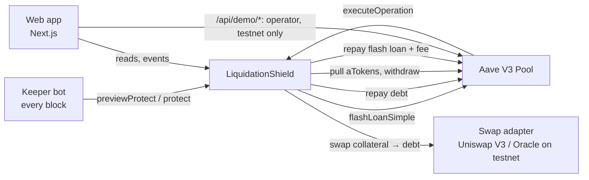

# Liquidation Shield

**Non-custodial, per-block liquidation protection for Aave V3 borrowers on Monad.** A permissionless `protect(user)` call deleverages a position with a flash loan, gradually across blocks, before it can be liquidated. The borrower keeps their position and pays a small fee instead of a 5% liquidation penalty.

Built at Monad Blitz (DevCon Mumbai).

## Live

| | |
|---|---|
| **Live demo** | **https://liquidation-shield-chi.vercel.app/demo**: Alice (unprotected) vs Bob (shielded); press **Slow crash** |
| Product page | https://liquidation-shield-chi.vercel.app/app: connect a wallet, get test tokens, open a loan, activate a Shield |
| Network | **Monad testnet** (chain 10143), explorer https://testnet.monadexplorer.com |

### Deployed contracts (Monad testnet)

| Contract | Address |
|---|---|
| **LiquidationShield** | [`0x15dc631a7c70ec62e699d2720b2111a6db944878`](https://testnet.monadexplorer.com/address/0x15dc631a7c70ec62e699d2720b2111a6db944878) |
| OracleSwapAdapter (testnet swap venue) | [`0xd74f3689ece97d3ed05decf002845a123a69073b`](https://testnet.monadexplorer.com/address/0xd74f3689ece97d3ed05decf002845a123a69073b) |
| TestnetAave (deployer) | [`0xc3793c6a1aef7d41c29c867da85299ba81d966ca`](https://testnet.monadexplorer.com/address/0xc3793c6a1aef7d41c29c867da85299ba81d966ca) |
| Pool (Aave V3-compatible) | [`0x6339399F37Ed89f2375F91BcA6E2a3D5a91aEE9c`](https://testnet.monadexplorer.com/address/0x6339399F37Ed89f2375F91BcA6E2a3D5a91aEE9c) |
| PoolAddressesProvider | [`0xc92DF615989792aF36e9c8B4cFd2083bf1F18b19`](https://testnet.monadexplorer.com/address/0xc92DF615989792aF36e9c8B4cFd2083bf1F18b19) |
| Price oracle | [`0x0DAB036ab5dCA755BE375f497386d3D2a31917A4`](https://testnet.monadexplorer.com/address/0x0DAB036ab5dCA755BE375f497386d3D2a31917A4) |
| tWETH / tUSDC | [`0x68A1F11cAB44Cb429525Ce83493E3Af079DfE2C3`](https://testnet.monadexplorer.com/address/0x68A1F11cAB44Cb429525Ce83493E3Af079DfE2C3) / [`0xbB4DEA231d7014fCA314c21832E1D4f0D413fbc7`](https://testnet.monadexplorer.com/address/0xbB4DEA231d7014fCA314c21832E1D4f0D413fbc7) |
| atWETH / variable-debt tUSDC | [`0xa2898A0d1Ce78aDde4292B0802e9F7d4dE46C904`](https://testnet.monadexplorer.com/address/0xa2898A0d1Ce78aDde4292B0802e9F7d4dE46C904) / [`0xe48d2043272Db0AC6CA6E567c10440D067d457ca`](https://testnet.monadexplorer.com/address/0xe48d2043272Db0AC6CA6E567c10440D067d457ca) |
| Keeper (EOA) | [`0x36C7426BC3fda7C40387c59d76A473a81DFcF112`](https://testnet.monadexplorer.com/address/0x36C7426BC3fda7C40387c59d76A473a81DFcF112) |

Aave and Uniswap aren't deployed on Monad testnet, so the demo runs against our own owner-gated, Aave V3-compatible test pool (`TestnetAave`) and an oracle-priced swap adapter. The Shield contract is unchanged: on mainnet it points at real Aave V3 and the Uniswap V3 adapter.

## How it works

1. A borrower **registers** a Shield config: trigger HF (e.g. 1.15), target HF (e.g. 1.40), max step (25% of debt) and max slippage (1%). Then they approve the Shield to pull their aTokens.
2. A **keeper** calls `previewProtect(user)` every block. When HF < trigger, it calls the permissionless `protect(user)`.
3. `protect` takes a **flash loan** of the debt asset, **repays** part of the debt, pulls the matching aToken collateral, **swaps** it back to the debt asset and repays the flash loan plus a small keeper fee. HF must strictly rise, or the call reverts.
4. Steps repeat block by block (**Unwind**) until HF is back at target. Then the Shield emits `UnwindComplete`.



Repo layout (npm workspaces): `contracts/` (Foundry), `packages/shared` (generated ABIs, addresses, network helpers), `keeper/` (TypeScript + viem), `demo/` (deploy / seed / crash / liquidator scripts), `web/` (Next.js App Router).

## Safety model

- **Non-custodial:** the Shield holds no funds after any call (asserted in tests after every Step). Leftover collateral is re-supplied to the user.
- **Bounded:** it only acts below the user's own trigger, only up to their target, and each Step is capped at `maxStepBps` of the debt and `maxSlippageBps` of the swap.
- **Order of operations:** debt is repaid **before** collateral aTokens are pulled, since aToken transfers re-check HF.
- **Costs are explicit:** k = (1 + slippage)·(1 + flash premium + keeper fee). The flash premium is read from the pool (`FLASHLOAN_PREMIUM_TOTAL`), never hardcoded.
- **Owner powers:** set the swap adapter, set the keeper fee (max 50 bps), and `pause`. There's no timelock. A malicious adapter can take at most the user's slippage cap per Step, and only below their trigger. `pause` only leaves users unprotected; it can't move funds.
- **MEV:** `protect` is permissionless and the swap is sandwichable, so the loss per Step is bounded by `maxSlippageBps` (default 1%). Full MEV protection is out of scope.
- **Liveness:** if our keeper is down, anyone can call `protect`. On-chain `Heartbeat` events make keeper uptime public.
- `TestnetAave` and `OracleSwapAdapter` are **testnet only**.

## Why Monad

A liquidation is a race against the next price update. Checking every position **every block** only makes sense when blocks are fast and transactions are cheap. Monad's ~0.4s blocks let the Shield act before HF reaches 1.0, and low fees mean per-block checks and small, gradual Steps cost fractions of a cent instead of a lump sale. On a slow, expensive chain you'd set the trigger far higher and sell in one big chunk. Monad lets the Shield deleverage gradually and just in time.

## Run it yourself

```bash
git submodule update --init --recursive && npm install
cp .env.example .env            # testnet keys only; fund OPERATOR from https://faucet.monad.xyz
npm run test:contracts          # forge test (unit + fuzz)
npm run demo:deploy             # once: TestnetAave, adapter, Shield; writes demo/.deployments.json, web/.env.local, keeper/.env
npm run demo:seed               # fresh Alice & Bob at HF 1.30, Bob shielded
npm run keeper                  # per-block keeper (official WS RPC, see .env.example)
npm run demo:liquidator         # liquidates Alice when HF < 1
npm run web                     # http://localhost:3000/demo → Slow crash
```

Hosting on Vercel: project root `web/`. Server env: `OPERATOR_PRIVATE_KEY`, `DEMO_MNEMONIC` (testnet only), `DEMO_DEPLOYMENTS` (the JSON from `demo/.deployments.json`), `DEPLOYMENTS_FILE=/tmp/deployments.json`, plus the public `NEXT_PUBLIC_*` vars from `web/.env.local`. The operator key never reaches the browser; reads go through a read-only `/api/rpc` proxy.

## Tests

- `forge test`: 95 tests (unit, Step, Unwind, fuzz, TestnetAave, adapters).
- `npm run test:keeper`: keeper tick behaviour with a stubbed viem client.
- End-to-end on Monad testnet: Reset → Slow crash. Alice is liquidated (5% penalty), and Bob unwinds over ~5 Steps to HF ≈ 1.40.
